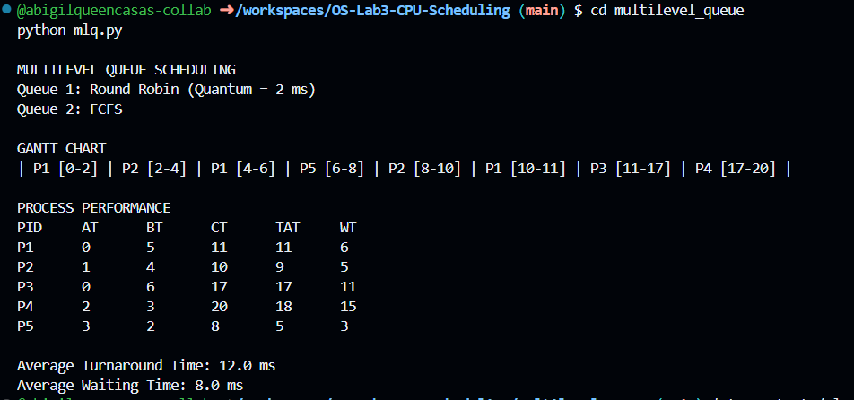
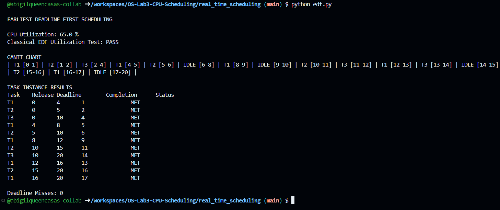

# OS Laboratory Activity 3
## Multilevel Queue and Real-Time CPU Scheduling

---

### I. Introduction

This laboratory activity focuses on the implementation and simulation of Multilevel Queue (MLQ) scheduling and two real-time CPU scheduling algorithms, Rate Monotonic Scheduling (RMS) and Earliest Deadline First (EDF), using Python. MLQ organizes processes into separate queues, each with its own scheduling policy. RMS and EDF schedule periodic real-time tasks based on period and deadline requirements. The outputs were analyzed through Gantt charts, and the source code and documentation were managed in a GitHub repository.

### II. Objectives

- Explain the operation of Multilevel Queue, RMS, and EDF scheduling algorithms.
- Implement MLQ scheduling using Round Robin and FCFS.
- Implement preemptive RMS and EDF scheduling simulations using Python.
- Generate and interpret Gantt charts showing process and task execution.
- Calculate CPU utilization, waiting time, turnaround time, and deadline compliance.
- Create and manage a GitHub repository containing Python source code and laboratory documentation.

### III. Scheduling Algorithms

1. **Multilevel Queue Scheduling (MLQ)** - The ready queue is divided into separate queues, and each process is permanently assigned to one queue. Each queue has its own scheduling algorithm, and the queues themselves are scheduled by priority. In this activity, Queue 1 (interactive processes) uses Round Robin with a 2 ms quantum, and Queue 2 (batch processes) uses FCFS. Queue 1 has strict priority over Queue 2.
2. **Rate Monotonic Scheduling (RMS)** - A fixed-priority preemptive algorithm for periodic tasks. The task with the shortest period receives the highest priority.
3. **Earliest Deadline First (EDF)** - A dynamic-priority preemptive algorithm. The ready task with the earliest absolute deadline (release time + relative deadline) runs first.

### IV. Program Implementation

All programs are written in Python 3 without external libraries. They simulate the CPU in 1 ms time steps and ignore context-switching overhead.

| Program | Location | Implementation |
| --- | --- | --- |
| `mlq.py` | `multilevel_queue/` | Uses two `deque` queues. At every millisecond, newly arrived processes are added to their queue. If Queue 1 has a process, it runs with a 2 ms quantum (Round Robin). Queue 2 runs (FCFS) only when Queue 1 is empty, and it is interrupted when a Queue 1 process arrives. It records Gantt segments and computes completion, turnaround, and waiting times. |
| `rms.py` | `real_time_scheduling/` | Generates every periodic task instance as a separate job (release time, absolute deadline, remaining time). At each millisecond, it selects the ready job whose task has the shortest period (ties: earlier release, then task ID). It reports utilization, the RMS bound, and the deadline status of each job. |
| `edf.py` | `real_time_scheduling/` | Uses the same job generation, but at each millisecond selects the ready job with the earliest absolute deadline (ties: earlier release, then task ID). It reports utilization, the EDF test, and the deadline status of each job. |

Output files are saved in `outputs/`, and execution screenshots are in `screenshots/`.

### V. Test Data

**MLQ (time quantum = 2 ms for Queue 1)**

| Process | Arrival Time (ms) | Burst Time (ms) | Queue |
| --- | --- | --- | --- |
| P1 | 0 | 5 | 1 |
| P2 | 1 | 4 | 1 |
| P3 | 0 | 6 | 2 |
| P4 | 2 | 3 | 2 |
| P5 | 3 | 2 | 1 |

**RMS and EDF (simulation time = 20 ms, deadline = period)**

| Task | Execution Time (C) | Period (T) | Relative Deadline (D) |
| --- | --- | --- | --- |
| T1 | 1 ms | 4 ms | 4 ms |
| T2 | 1 ms | 5 ms | 5 ms |
| T3 | 2 ms | 10 ms | 10 ms |

### VI. Results and Discussion

#### A. Multilevel Queue Scheduling

**Gantt Chart**

```
| P1 [0-2] | P2 [2-4] | P1 [4-6] | P5 [6-8] | P2 [8-10] | P1 [10-11] | P3 [11-17] | P4 [17-20] |
```

**Process Performance**

| PID | AT | BT | CT | TAT | WT |
| --- | --- | --- | --- | --- | --- |
| P1 | 0 | 5 | 11 | 11 | 6 |
| P2 | 1 | 4 | 10 | 9 | 5 |
| P3 | 0 | 6 | 17 | 17 | 11 |
| P4 | 2 | 3 | 20 | 18 | 15 |
| P5 | 3 | 2 | 8 | 5 | 3 |

- **Average Turnaround Time:** 12.0 ms
- **Average Waiting Time:** 8.0 ms

**Discussion:** All Queue 1 processes (P1, P2, P5) finished by time 11 ms, using Round Robin with a 2 ms quantum so that they alternated. P3 and P4 (Queue 2) only began at 11 ms even though P3 arrived at 0 ms, which confirms that Queue 1 has strict priority over Queue 2. As a result, the batch processes had the longest waiting times (P3 = 11 ms, P4 = 15 ms), while P5 had the shortest (3 ms).



#### B. Rate Monotonic Scheduling

**Priority Order:** T1 (period 4) > T2 (period 5) > T3 (period 10)

**CPU Utilization:** U = 1/4 + 1/5 + 2/10 = 0.25 + 0.20 + 0.20 = 0.65 = **65%**

**RMS sufficient bound:** 3(2^(1/3) - 1) = **77.98%**. Since 65% is below 77.98%, the task set passes the sufficient-bound test.

**Gantt Chart**

```
| T1 [0-1] | T2 [1-2] | T3 [2-4] | T1 [4-5] | T2 [5-6] | IDLE [6-8] | T1 [8-9] | IDLE [9-10] | T2 [10-11] | T3 [11-12] | T1 [12-13] | T3 [13-14] | IDLE [14-15] | T2 [15-16] | T1 [16-17] | IDLE [17-20] |
```

**Task Instance Results**

| Task | Release | Deadline | Completion | Status |
| --- | --- | --- | --- | --- |
| T1 | 0 | 4 | 1 | MET |
| T2 | 0 | 5 | 2 | MET |
| T3 | 0 | 10 | 4 | MET |
| T1 | 4 | 8 | 5 | MET |
| T2 | 5 | 10 | 6 | MET |
| T1 | 8 | 12 | 9 | MET |
| T2 | 10 | 15 | 11 | MET |
| T3 | 10 | 20 | 14 | MET |
| T1 | 12 | 16 | 13 | MET |
| T2 | 15 | 20 | 16 | MET |
| T1 | 16 | 20 | 17 | MET |

**Deadline Misses:** 0

**Discussion:** T1 always ran first whenever it was released, followed by T2 and T3, which matches the fixed priorities. All 11 task instances completed before their deadlines. The CPU was idle for 7 of the 20 ms (6-8, 9-10, 14-15, and 17-20), which matches the computed 65% utilization (13 ms busy out of 20).


#### C. Earliest Deadline First

**CPU Utilization:** 65% (same task set). **Classical EDF test:** PASS (U <= 100%).

**Gantt Chart**

```
| T1 [0-1] | T2 [1-2] | T3 [2-4] | T1 [4-5] | T2 [5-6] | IDLE [6-8] | T1 [8-9] | IDLE [9-10] | T2 [10-11] | T3 [11-12] | T1 [12-13] | T3 [13-14] | IDLE [14-15] | T2 [15-16] | T1 [16-17] | IDLE [17-20] |
```

**Task Instance Results**

| Task | Release | Deadline | Completion | Status |
| --- | --- | --- | --- | --- |
| T1 | 0 | 4 | 1 | MET |
| T2 | 0 | 5 | 2 | MET |
| T3 | 0 | 10 | 4 | MET |
| T1 | 4 | 8 | 5 | MET |
| T2 | 5 | 10 | 6 | MET |
| T1 | 8 | 12 | 9 | MET |
| T2 | 10 | 15 | 11 | MET |
| T3 | 10 | 20 | 14 | MET |
| T1 | 12 | 16 | 13 | MET |
| T2 | 15 | 20 | 16 | MET |
| T1 | 16 | 20 | 17 | MET |

**Deadline Misses:** 0

**Discussion:** At every millisecond, EDF picked the ready task with the earliest absolute deadline. For this task set, the resulting Gantt chart is identical to RMS, because the earliest-deadline task was also the shortest-period task at each decision point. The two algorithms can produce different schedules for other task sets. All task instances met their deadlines.



### VII. Algorithm Comparison

| Criteria | MLQ | RMS | EDF |
| --- | --- | --- | --- |
| Scheduling basis | Queue priority | Task period | Absolute deadline |
| Priority assignment | Fixed queue priority | Fixed task priority | Dynamic task priority |
| Scheduling type | Depends on queue policy | Preemptive | Preemptive |
| Main application | Process classification | Periodic real-time tasks | Deadline-based real-time tasks |
| Deadline monitoring | Not inherent | Yes | Yes |

MLQ is a general-purpose approach for separating process types (such as interactive and batch), but it has no built-in notion of deadlines. RMS and EDF are designed for real-time systems. RMS is simpler because its priorities never change, while EDF can use the CPU more fully (up to 100% under classical assumptions) because priorities are recalculated based on deadlines.

### VIII. Guide Questions

**1. What is the main difference between Multilevel Queue and Multilevel Feedback Queue scheduling?**
In MLQ, a process is permanently assigned to one queue and never moves. In Multilevel Feedback Queue, processes can move between queues based on their behavior (for example, a process that uses too much CPU time is moved to a lower-priority queue, and a long-waiting process can be moved up to prevent starvation).

**2. Why does MLQ use different scheduling algorithms for different process queues?**
Different process types have different needs. Interactive processes need fast response, so Round Robin gives them short turns. Batch processes care more about throughput and do not need quick response, so a simple algorithm like FCFS is enough. Using a different algorithm per queue lets the system fit each type's needs.

**3. How does RMS determine which task receives the CPU first?**
RMS compares the periods of the ready tasks. The task with the shortest period gets the highest priority and runs first. In this lab, T1 (period 4 ms) ran before T2 (5 ms) and T3 (10 ms).

**4. Why is RMS considered a fixed-priority scheduling algorithm?**
Priorities are assigned once, based on each task's period, and never change while the system runs. T1 is always higher than T2, and T2 is always higher than T3.

**5. How does EDF determine which task should execute next?**
EDF looks at all ready tasks and picks the one with the earliest absolute deadline (release time + relative deadline). Ties are broken by earlier release time, then by task ID in our program.

**6. Why is EDF considered a dynamic-priority scheduling algorithm?**
A task's priority depends on its absolute deadline, which changes with every new release. The same task can therefore have a higher or lower priority than another task at different times. For example, T2 released at 5 ms has an absolute deadline of 10 ms, which differs from its first deadline of 5 ms.

**7. What happens when a newly released task has an earlier deadline than the currently running task under EDF?**
Because EDF is preemptive, the running task is interrupted and the newly released task takes the CPU. The preempted task keeps its remaining execution time and resumes later when it again has the earliest deadline among the ready tasks.

**8. Why is CPU utilization important in real-time scheduling?**
Utilization (the sum of C/T for all tasks) shows how much of the processor's capacity the tasks need. It is used in schedulability tests to check whether all deadlines can be met. In our task set it is 65%, so the system has spare capacity.

**9. Can a task set with CPU utilization below 100% still miss a deadline? Explain the conditions under which this may happen.**
Yes. Under a fixed-priority algorithm like RMS, utilization below 100% does not guarantee schedulability. The RMS bound (about 77.98% for 3 tasks) is only sufficient, so a task set above the bound may or may not be schedulable, and it can miss deadlines even when U is below 100%. Deadlines can also be missed when relative deadlines are shorter than periods, when there is context-switching overhead, when tasks block on shared resources (priority inversion), when parts of tasks cannot be preempted, or when tasks are not independent. The EDF "U <= 1" rule only applies under the classical assumptions (independent, preemptible tasks on one processor with deadlines equal to periods).

**10. Which algorithm would you recommend for periodic real-time tasks, RMS or EDF? Justify your answer.**
For the task set in this lab, both worked equally well, with 65% utilization and no missed deadlines. In general, I would recommend EDF, because it is optimal on a single processor: it can schedule any feasible task set up to 100% utilization, while RMS may fail above its bound. RMS is still a good choice when simplicity and predictability matter, because its fixed priorities are easier to implement and analyze, and it behaves more predictably during overload.

### IX. Conclusion

In this laboratory activity, I implemented and tested Multilevel Queue, Rate Monotonic, and Earliest Deadline First scheduling in Python. The MLQ simulation showed how queue priority and different per-queue algorithms affect waiting and turnaround time (average turnaround 12.0 ms, average waiting 8.0 ms). The RMS and EDF simulations showed that the task set with 65% utilization met all deadlines under both algorithms. I also learned to read Gantt charts, compute utilization and schedulability, and use GitHub to organize source code, output files, screenshots, and documentation.
